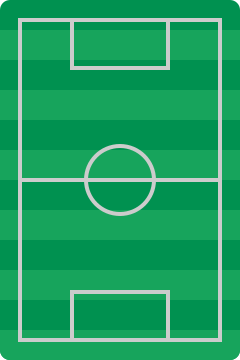

Credits
===

All artwork and third-party assets used in this project are credited to their respective creators below. I'm very
grateful to the hardworking people who make these so I don't have to.

# Third party

- [Raylib](https://github.com/raysan5/raylib), **6.2**, by Ramon Santamaria and contributors
  (zlib/libpng license).
- [raygui](https://github.com/raysan5/raygui), **5.0**, by Ramon Santamaria and contributors
  (zlib/libpng license).
- [utf8proc](https://github.com/JuliaStrings/utf8proc), **2.12.0**, by its contributors
  (MIT/Expat and Unicode data licenses).
- [Noto Sans](https://github.com/notofonts/noto-fonts/tree/ffebf8c1ee449e544955a7e813c54f9b73848eac/hinted/ttf/NotoSans),
  regular and bold, from commit `ffebf8c1ee449e544955a7e813c54f9b73848eac`
  (SIL Open Font License 1.1; `assets/fonts/OFL.txt`).
- [GNU Unifont 16.0.04](https://unifoundry.com/pub/unifont/unifont-16.0.04/font-builds/unifont-16.0.04.otf),
  by the GNU Unifont contributors, used as a lazy international glyph fallback.
  The exact release's full `COPYING` is included as `assets/fonts/Unifont-LICENSE.txt`
  (SIL OFL 1.1 and GPL 2-or-later with the font embedding exception).

Dependency revisions are pinned in `cmake/dependencies.cmake`. Their license files and the font
licenses accompany installed applications. Raylib also contains its upstream third-party
components/notices: GLFW, Khronos OpenGL definitions and QOI notices accompany the binaries;
stb and sdefl/sinfl use their public-domain alternatives. Preserve the upstream source notices
when redistributing dependency source.

- [Footprint icon](https://www.svgrepo.com/svg/34889/human-shoes-footprints) provided by
  svgrepo.com \[[Public Domain licence](https://www.svgrepo.com/page/licensing/#CC0)\]
	- This was modified to remove the left footprint and make the right footprint a little smaller.
- [Heart icon](https://www.svgrepo.com/svg/362109/heart) provided by
  svgrepo.com \[[Public Domain licence](https://www.svgrepo.com/page/licensing/#PD)\]
- [Smiley face icon](https://www.svgrepo.com/svg/436893/smiley-fill) provided by
  svgrepo.com \[[MIT licence](https://www.svgrepo.com/page/licensing/#MIT)\]
- [Magnifying glass](https://www.svgrepo.com/svg/479646/magnifying-glass-9) provided by
  svgrepo.com \[[Public Domain licence](https://www.svgrepo.com/page/licensing/#CC0)\]
	- This was modified to remove the glare from the lens
- [Football](https://www.svgrepo.com/svg/475619/football-2) provided by
  svgrepo.com \[[CC Attribution licence](https://www.svgrepo.com/page/licensing/#CC%20Attribution)\]
	- This has been recoloured
- [252 country flags](https://en.wikipedia.org/wiki/List_of_FIFA_country_codes) provided by
  Wikipedia \[Public Domain licence\]

The Raylib PNG pitch/heart/face/foot assets are raster derivatives of the existing project artwork
and icon outlines, not new generated artwork.

# First party

The following assets were created by me for this project. They are licensed under
the [CC BY 4.0](https://creativecommons.org/licenses/by/4.0/) licence.

- 
- 
